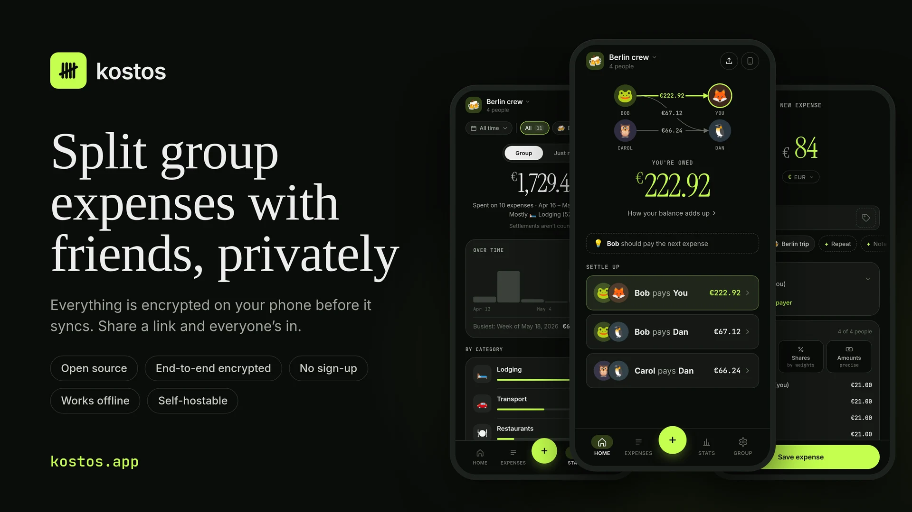
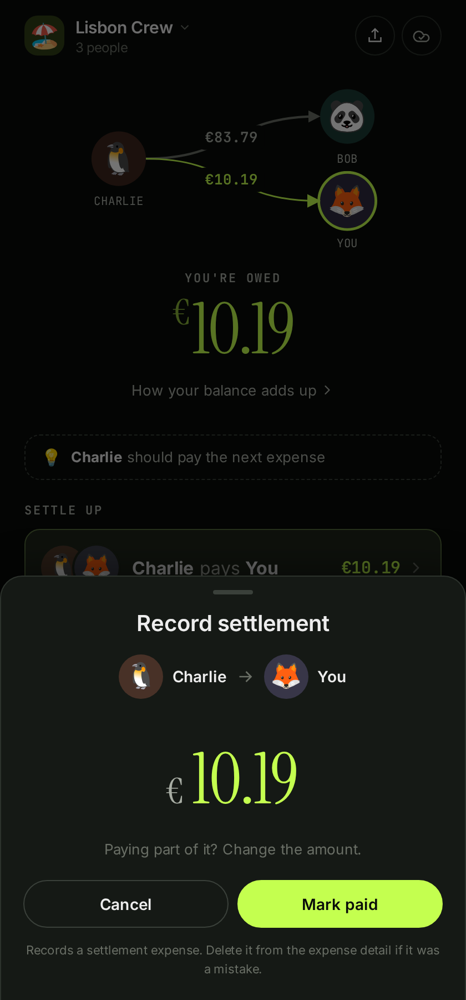
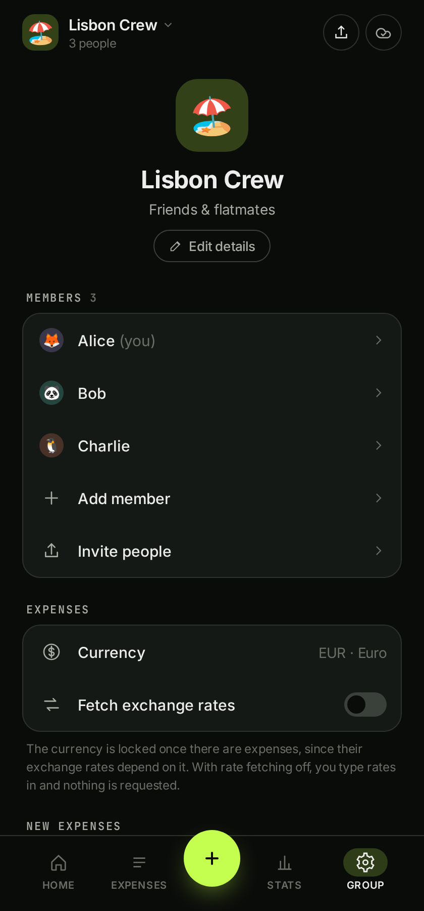

<h1 align="center">Kostos</h1>

<p align="center"><strong>Split group expenses with friends, privately.</strong><br/>No accounts, works offline, end-to-end encrypted, and you can host it yourself.</p>

<p align="center">
  <a href="https://kostos.app">Live demo</a> ·
  <a href="#screenshots">Screenshots</a> ·
  <a href="#self-hosting">Self-hosting</a> ·
  <a href="#how-it-works">How it works</a>
</p>

<p align="center"></p>

Kostos is an app for splitting expenses with friends, flatmates or whoever you're travelling with. You create a group, send the invite link to the people you want in and start adding expenses. Nobody signs up or gives an email. Changes show up live on every device that has the link, and once you've opened a group it keeps working offline.

Everything is encrypted on your device before it syncs. The key lives in the invite link, so the server only ever stores data it can't read; [How it works](#how-it-works) has the details.

Try it at [kostos.app](https://kostos.app). The demo has sample data and needs no sign-up.

## Features

### Splitting

- Split evenly, by shares or by exact amounts. Amount fields accept maths like `(120+5)/4`, and because phone number pads have no operators, a row of `+ − × ÷ ( )` keys sits above the keyboard.
- Several people can pay for one expense, each with the amount they actually paid.
- Give each member a default weight (1 and 2 for a household that splits 1:2, for example), or let new expenses copy the last split you used. It only pre-fills the form, so you can still change any expense.
- Repeat rent, subscriptions and other regular costs weekly, monthly or yearly. If nobody opens the group for a while, the missed copies are added the next time someone does. Every device creates exactly the same copies, so you never get duplicates.
- Tag expenses to a trip, like a holiday or a party, and filter the home screen and stats by it. Trips fold away 30 days after they end, while balances and settle up always cover the whole group.

### Balances and stats

- Settle up works out the fewest payments that bring everyone to zero and draws them as a graph on the home screen. Tap one to record it, for the full amount or just part of it. "How your balance adds up" shows what you paid, your share and what's been paid back.
- Use any of 153 currencies. Each expense keeps the exchange rate from when it was added, so its value never drifts, and the day's rate is cached on your device so foreign expenses work offline. You can also type rates in yourself.
- Stats cover all time, a month or a year, optionally for a single trip, and either the whole group or just your share. You get spending by day, week or month (tap a bar for its total), categories you can tap to see their expenses, what each person paid against their share, and the biggest expenses.

### Groups and sync

- There are no accounts: anyone with the invite link can join. When you're together, one phone shows a QR code and the other scans it.
- It's an installable PWA that works offline. Add expenses on a plane and they sync when you land.
- If two devices edit the same expense at once, Kostos keeps both versions and asks which one to use. Either way, the expense is counted once.
- The sync button in the header tells you whether everything is up to date, saved only on this device or failing to sync, and why.
- Coming from Splitwise? Upload its CSV export to get a group with the same members, expenses, exact shares and payments.
- Back up a group from the Group tab as JSON (lossless) or CSV (one row per expense, for spreadsheets). Restoring the JSON creates a new group with all its members, categories, payment methods, trips and expenses.
- Keep as many groups as you like on one device and switch between them from the start screen.

## Screenshots

<table>
<tr>
<td align="center" width="33%">
<br/>
<sub>Balances home</sub>
</td>
<td align="center" width="33%">
<br/>
<sub>Settle up</sub>
</td>
<td align="center" width="33%">
<br/>
<sub>Multi-currency</sub>
</td>
</tr>
<tr>
<td align="center" width="33%">
<br/>
<sub>Math toolbar</sub>
</td>
<td align="center" width="33%">
<br/>
<sub>Stats</sub>
</td>
<td align="center" width="33%">
<br/>
<sub>Group and members</sub>
</td>
</tr>
</table>

## Self-hosting

Kostos is a static site plus a small WebSocket relay for sync, and a single Docker image runs both.

> [!IMPORTANT]
> Kostos has to be served over HTTPS, behind a reverse proxy. The app encrypts in the browser with WebCrypto, which browsers only allow on HTTPS or `localhost`, so on a plain `http://` address on your network groups can't be created, joined or synced.

### Docker

```yaml
services:
  kostos:
    image: ghcr.io/shynewt/kostos:3
    restart: unless-stopped
    ports:
      - "8080:8080"
    volumes:
      - kostos-data:/data

volumes:
  kostos-data:
```

Or with `docker run`:

```sh
docker run -d -p 8080:8080 -v kostos-data:/data --restart unless-stopped ghcr.io/shynewt/kostos:3
```

Each release publishes a multi-arch image (`linux/amd64`, `linux/arm64`) to GitHub Container Registry. `:3` follows every stable 3.x release, `:3.0` only gets patch releases and `:3.0.0` never changes.

For HTTPS, [Caddy](https://caddyserver.com/docs/quick-starts/reverse-proxy) is the quickest option. It gets a certificate for your domain by itself and passes the sync WebSocket through:

```sh
caddy reverse-proxy --from kostos.example.com --to localhost:8080
```

When Caddy runs on the same host, publish the port as `127.0.0.1:8080:8080` (or `-p 127.0.0.1:8080:8080` with `docker run`) so plain HTTP isn't exposed on your LAN. Anyone can create rooms on a public server, so also put a rate limit on `/sync/` in your proxy.

To build the image yourself:

```sh
docker build -t kostos --build-arg PUBLIC_APP_VERSION="$(git describe --tags --abbrev=0 | sed 's/^v//')" .
```

### Node, without Docker

```sh
npm install
npm run build
node scripts/serve.js
```

`scripts/serve.js` serves the app and the sync relay on the same port (8080 by default). Set `KOSTOS_DATA_DIR` to a persistent directory (the default is `.kostos-data/serve`; Docker uses `/data`) and keep it across restarts and upgrades.

### Cloudflare Workers

kostos.app runs on Cloudflare, with the sync relay in a Durable Object, and it fits in the Workers Free plan. Set your domain in `wrangler.toml`, then run `npm run cf:deploy`; [Deploying to Cloudflare Workers](docs/cloudflare.md) has the details.

### Running a server

[Running a Kostos server](docs/self-hosting.md) covers storage limits, what happens when a group gets full, and the rest of the operating notes.

### Upgrading to v3

v3 changed the sync protocol, so groups on a v2 server move to new invite links through export and restore. Follow [Upgrading a self-hosted server to v3](docs/upgrading-to-v3.md), which also covers moving from v1.

## How it works

Each group has a random 22-character key, and the invite link carries it after the `#`, a part of the URL that browsers never send to the server. From that key the browser derives everything else with HKDF-SHA-256: an AES-128-GCM key that encrypts every change before it leaves the device, a relay room ID, an access proof, and a local ID for the app's own URLs. The relay lets a room's first client register its proof and turns away anyone who can't present it.

### What the server can and can't see

- It can't read your expenses, amounts, member names or the group's name. All of that is inside the encrypted updates.
- It does see the relay room ID, the access proof, when devices connect, their IP addresses and the size of each encrypted update.
- Anyone who has ever had the invite link can read the group, including everything added later. Removing a member doesn't take away their key, so to lock someone out, export a backup and restore it as a new group with a new link.
- You trust whoever serves the app's code. A malicious server could ship JavaScript that reads the key, as with any end-to-end encrypted web app, which is one reason to self-host.
- Fetching exchange rates sends the currency code from your device to [open.er-api.com](https://open.er-api.com). Turn it off in the Group tab if you'd rather not.

### Sync

Group state is a Y.js CRDT document stored in IndexedDB, so it works offline and merges when devices reconnect. The client only shows "Up to date" after it has replayed the encrypted history, uploaded its saved document, received acknowledgements for its writes and checked an ordered server barrier. At that point the device matches the relay as of the time shown, though another member's offline changes can't appear until that member reconnects. The saved document is uploaded on every connection, so sending and recovery don't depend on anyone else being online.

### Stack

- Svelte 5 on SvelteKit 2, built as a static site, in strict TypeScript.
- Y.js and IndexedDB for local-first state, with one `Y.Doc` per group.
- A Cloudflare Durable Object as the sync relay on kostos.app, using `acceptWebSocket()` hibernation so idle rooms cost nothing.
- For self-hosting, a small Node `http` and `ws` relay that speaks the same wire protocol.

## Development

```sh
npm install
npm run sync # run in a separate terminal
npm run dev
```

That opens `http://localhost:5173/`. The dev server proxies `/sync/*` to `ws://localhost:1234`, where `npm run sync` runs the same relay as the self-host server, keeping its encrypted history in `.kostos-data/dev`. Skip it if you're only working offline; IndexedDB keeps your group state locally.

| Command | Purpose |
| --- | --- |
| `npm run dev` | Vite dev server on `:5173`. |
| `npm run build` | Static build into `build/` (adapter-static, SPA fallback on `200.html`). |
| `npm run preview` | Serve the built bundle locally. |
| `npm run check` | Type-check via svelte-check. |
| `npm test` | Vitest unit and relay tests, including encrypted sync and Durable Object migration. |
| `npm run test:e2e` | Browser tests against the production build; captures sync screenshots in `docs/screenshots/sync/`. Run `npm run build` first. |
| `npm run sync` | Local Node `ws` relay on port 1234 for dev sync. |
| `npm run cf:dev` | `wrangler dev` with local Durable Object emulation. |
| `npm run cf:deploy` | Build + deploy to Cloudflare Workers. |
| `npm run screenshots` | Regenerate the README screenshots via Playwright (a server must be running; defaults to `:5173`). |

## License

AGPL-3.0-only, see [LICENSE](LICENSE). If you run a modified version as a network service, you have to make its source available to its users.
