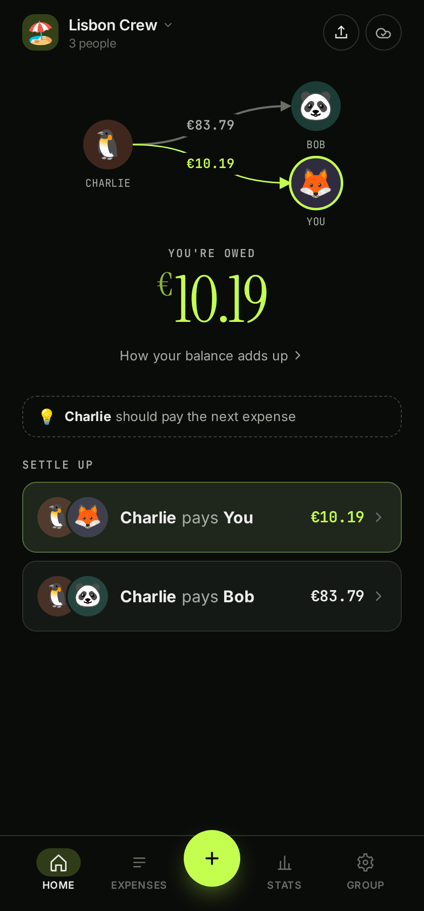
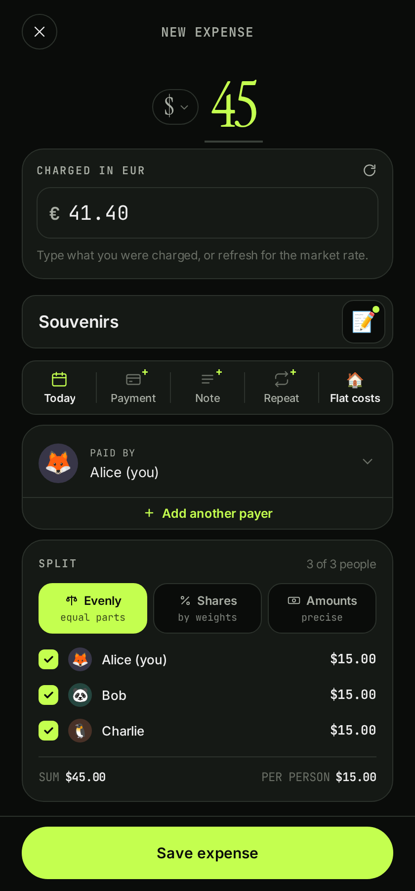
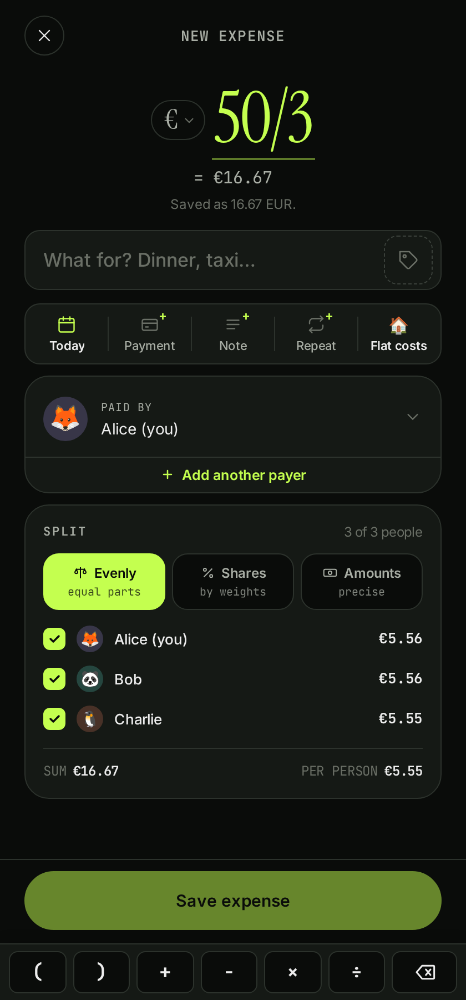
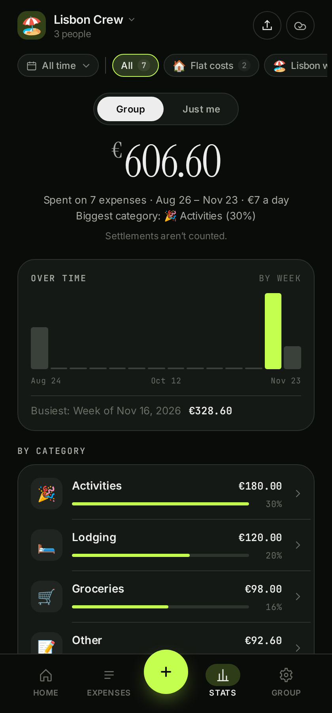
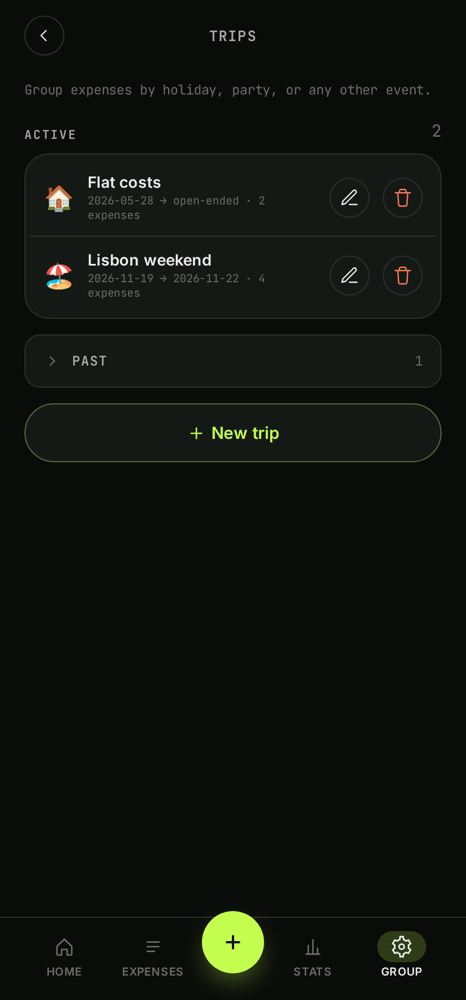

<h1 align="center">Kostos</h1>

<p align="center"><strong>Privacy-first group expense splitter PWA</strong>. No accounts. End-to-end encrypted. Works offline. Self-hostable.</p>

<p align="center">
  <a href="https://APP_DOMAIN">Live demo</a> ·
  <a href="#screenshots">Screenshots</a> ·
  <a href="#deploy">Deploy</a> ·
  <a href="#why-v2-and-v3">Why v2 and v3</a>
</p>

Kostos is a small web app for splitting bills with friends, housemates, or trip groups. Create a group, share its invite link, log expenses, settle up. No sign-up, no email, no password. Group state syncs live across every device that has the invite link, and stays readable offline once you've opened it.

## Features

- **No accounts.** A group is identified by a 22-character group key, and the invite link (the URL you share) carries it. Anyone with the link joins. The server never sees the key.
- **End-to-end encrypted sync.** Every update is AES-GCM encrypted in the browser before reaching the sync relay. The relay stores opaque ciphertext.
- **Offline-first PWA.** Built on Y.js + IndexedDB. Add expenses on a plane; they sync the moment you come back online.
- **Concurrent expense edits.** Each expense is counted once. If devices edit it independently, Kostos preserves both versions and asks you to review which one to use.
- **Clear sync status.** Balances wait for the initial online check. A compact status strip shows when expenses are current, saved only on this device, offline, or unable to sync; tap it for the last successful sync, when confirmation stopped, and the failure reason.
- **Three split modes.** Evenly, by weighted shares, or by precise per-person amounts. Math expressions like `(120+5)/4` work inside any amount input, and a floating row of `+ − × ÷ ( )` keys docks above the on-screen keyboard so the operators aren't trapped behind a digit-only layout.
- **Default split.** Give each member a fixed weight (say 1 and 2 for a household that shares 1:2), or have new expenses copy the split you used last. It only pre-fills the form; every expense can still be changed.
- **Multi-payer expenses.** When two people split the bill at dinner, both can be recorded as payers with the actual amounts each fronted.
- **Multi-currency.** Log an expense in any of 153 currencies, searchable by code or name with the most common ones on top. Kostos freezes the exchange rate onto it at creation, so the figure never drifts later, and converts everything back to the group's base currency for balances and stats. The day's rate is fetched by default (turn it off in Settings to type rates by hand) and cached per device, so adding a foreign expense works offline. Zero-decimal currencies like JPY are handled correctly.
- **Trips.** Tag expenses to a holiday, party, or any event with its own emoji and date range. Filter the home recents and stats page to a single trip. Past trips fold into a bottom sheet 30 days after they end, keeping the chip strip short. Balances and settlements stay global across the whole group.
- **Settle up.** A minimum-transfer plan suggests the fewest payments needed to bring everyone to zero. The home screen draws it as a payers-to-receivers graph; tap any transfer to record it as a settlement expense.
- **Stats.** Per-period spend, daily/weekly/monthly bars, by-category donut, who-paid bars, and biggest expenses.
- **Backup and restore.** Export any group as JSON (lossless backup) or CSV (one row per expense for spreadsheets) from Settings > Data. Restore a JSON file as a new group to bring back members, categories, payment methods, trips, and every expense.
- **QR invites.** Show the QR on one phone, scan on the other, you're in.
- **Multi-group.** A single device can hold many groups; switch between them from the landing.

## Screenshots

<table>
<tr>
<td align="center" width="33%">
<br/>
<sub>Balances home</sub>
</td>
<td align="center" width="33%">
<br/>
<sub>Settle up</sub>
</td>
<td align="center" width="33%">
<br/>
<sub>Multi-currency</sub>
</td>
</tr>
<tr>
<td align="center" width="33%">
<br/>
<sub>Math toolbar</sub>
</td>
<td align="center" width="33%">
<br/>
<sub>Stats</sub>
</td>
<td align="center" width="33%">
<br/>
<sub>Manage trips</sub>
</td>
</tr>
</table>

Screenshots are captured by `npm run screenshots` (see [Development](#development)).

## Deploy

Two supported targets sharing the same static bundle and the same `/sync/<relay room ID>` WebSocket route.

### Cloudflare Workers (with static assets + Durable Objects)

```sh
npm install
npx wrangler login
npm run cf:deploy
```

`worker/index.ts` is the entry. It routes `/sync/*` to a `SyncRoom` Durable Object (in `src/lib/server/sync-do.ts`) and falls through to the static assets binding for everything else. The DO uses Hibernating WebSockets, so idle rooms cost no CPU.

Configuration lives in `wrangler.toml`. The Worker is named `kostos-app` and has its own Durable Object namespace, so rooms on an older Worker are left alone and do not move. `workers_dev` and `preview_urls` are off, which means the only public address is your custom domain, and that domain's zone has to be on your Cloudflare account. Before deploying, replace `APP_DOMAIN` in the route pattern of `wrangler.toml`. If you deploy through `.github/workflows/release.yml`, also replace it in the `url:` of the `production` environment; the workflow refuses to run while either one is still a placeholder. Edit the route pattern and that `url:` only, not the whole repo: the guard survives a global search-and-replace (it builds its search word from two pieces), but it would also rewrite the placeholders in `docs/migration`.

If you keep a custom domain that the older `kostos` Worker already serves, remove the domain from that Worker in the Cloudflare dashboard first. A custom domain can point at one Worker only, so the `kostos-app` deploy fails while the old one holds it.

A room is addressed by a 64-character hex ID derived from the group key. The first client to connect stores a hash of its access proof; any other proof is answered with a `denied` message and a 1008 close. The Node relays apply the same rule and keep the hash in `<hash>.auth` next to the room log `<hash>.jsonl` (the file name is the SHA-256 of the relay room ID).

`wrangler.toml` turns off Workers invocation logs so the access proof in the `Sec-WebSocket-Protocol` header isn't retained. Cloudflare's edge and any Logpush job you add yourself sit outside that setting, and the server sees the relay room ID and proof by design.

The SQLite-backed DO works on the Workers Free plan; no Workers Paid required for typical use.

### Docker / self-host

> [!IMPORTANT]
> Kostos has to be served over HTTPS, behind a reverse proxy. The app encrypts in the browser with WebCrypto, which browsers only allow on HTTPS or `localhost`, so on a plain `http://` address on your network groups can't be created, joined or synced.

```yaml
services:
  kostos:
    image: ghcr.io/shynewt/kostos:3
    restart: unless-stopped
    ports:
      - "8080:8080"
    volumes:
      - kostos-data:/data

volumes:
  kostos-data:
```

Or with `docker run`:

```sh
docker run -d -p 8080:8080 -v kostos-data:/data --restart unless-stopped ghcr.io/shynewt/kostos:3
```

Each release publishes a multi-arch image (`linux/amd64`, `linux/arm64`) to GitHub Container Registry. `:3` follows every stable 3.x release. `:3.0` only gets patch releases and `:3.0.0` never changes. Pre-releases get their own version tag and nothing else.

For HTTPS, [Caddy](https://caddyserver.com/docs/quick-starts/reverse-proxy) is the quickest way. It gets a certificate for your domain by itself and passes the sync WebSocket through:

```sh
caddy reverse-proxy --from kostos.example.com --to localhost:8080
```

When Caddy runs on the same host, publish the port as `127.0.0.1:8080:8080` (or `-p 127.0.0.1:8080:8080` with `docker run`) so plain HTTP isn't exposed on your LAN.

To build the image yourself instead:

```sh
docker build -t kostos --build-arg PUBLIC_APP_VERSION="$(git describe --tags --abbrev=0 | sed 's/^v//')" .
```

Or without Docker:

```sh
npm install
npm run build
node scripts/serve.js
```

`scripts/serve.js` serves the static bundle and handles `/sync/<relay room ID>` WebSocket upgrades on the same port (default 8080). Encrypted history is appended to disk and flushed before a write is acknowledged. Set `KOSTOS_DATA_DIR` to a persistent directory (default `.kostos-data/serve`; Docker uses `/data`). Keep that directory or Docker volume across restarts and upgrades. Serve it behind an HTTPS reverse proxy.

Abuse beyond a single room is not handled in code. Put a rate limit on `/sync/` in your reverse proxy (for example nginx `limit_req` or Traefik's `rateLimit` middleware).

#### Upgrading to v3

v3 changes the sync protocol, so each group gets a new invite link. Members' data survives through export and restore. This guide is for Docker and Node self-hosters; on Cloudflare, deploy the `kostos-app` Worker as described above and move groups the same way.

1. Ask members to open the app online once, so their devices hold the latest data. After the upgrade, an installed app keeps running v2 until the member taps Update on the "A new version of Kostos is ready." prompt. Until then it shows Offline and new edits pile up on the phone.
2. Pull the new image (change the tag from `:2` to `:3` if you pin it) and restart. Same volume, same variables, same port. If you run `:latest`, the pull is the upgrade, so finish step 1 first.
3. Check that the server is reached over HTTPS.
   - v2 sync needed HTTPS as well, so a plain-HTTP address wasn't syncing before. What v3 adds is that new group, restore and join refuse to start there and show "Kostos needs HTTPS (or localhost) to encrypt your data."
   - Moving a LAN server behind HTTPS changes the web address, and a device's saved groups stay with the old address.
   - So export each group at the old address first (v3 still opens it there and offers Export backup), then restore the file at the new HTTPS address.
4. Once a member has tapped Update, open each group on one of their devices. v3 recognises the old format, does not try to sync it, and shows a banner ("This group no longer syncs.") with two buttons: Export backup, and Restore as a new group.
5. Restore on that device: choose the backup file, then look at "Which member are you?". It preselects the first member in the list, so pick yourself if that isn't you (after restoring, Settings > Switch does the same). Tap Restore on this device, then use the Share icon at the top of the new group to send its invite link. Everyone else joins that link. Only one person per group does steps 4 and 5.

   The old copy stays on each phone and shows as "No longer syncs". Once the new group looks right, open the old one, go to Settings and tap "Forget this group on this device". That deletes the old data on that phone, so export first.
6. When everyone has moved, delete the old logs. A v3 group's log (`<hash>.jsonl`) has a `<hash>.auth` file next to it; an old one doesn't. This removes only the `.jsonl` files without an `.auth` partner:

   ```sh
   docker compose exec kostos sh -c 'for f in /data/*.jsonl; do [ -e "$f" ] || continue; [ -e "${f%.jsonl}.auth" ] || rm "$f"; done'
   ```

   With plain `docker run`, use `docker exec <container> sh -c '...'` with the same script, or run it against the files directly if you aren't using Docker (swap `/data` for your `KOSTOS_DATA_DIR`). If you're unsure whether everyone has moved, leave the files alone; they cost disk space and nothing else.

A restore keeps members, categories, payment methods, trips and expenses. It does not keep the activity log or conflict history, and whoever restores picks which member they are again.

### Limits and operating notes

- Run one server process per data directory. Room claims aren't locked across processes, so two processes sharing a directory can split a room.
- A room refuses writes once it holds 32 MiB of live history or 100,000 live entries, whichever comes first. The app then says "This group is full, so new changes stay on this phone. Export a backup from Settings and restore it as a new group." and retries about every five minutes, or when someone taps Try again. A full group can still be exported and restored.
- On Cloudflare the Durable Object frees live space when a synced device compacts its history. The replaced entries move to an archive that is capped at another 32 MiB; once the archive is full, its oldest entries are dropped to make room for newer ones.
- The Node relay never compacts, so its caps are permanent. A group that reaches them needs a backup exported from Settings and restored as a new group.
- The Node relay keeps one small `.auth` file per room and anyone can create rooms, so put a rate limit in front of a public server (a reverse proxy rule, or a Cloudflare rule on `/sync/*`).
- Whoever knows a relay room ID before the group's first connection can claim it, and after that only the group's proof gets in. The operator is trusted until that first connection.
- The Docker `HEALTHCHECK` follows `PORT` but always probes `127.0.0.1`.

## Why v2 and v3

Kostos v1 was a Next.js + SQLite app where the server held every group's data. It worked, but it tied users to whatever instance hosted it and made the privacy story awkward: the operator could read every group. v2 rewrites the foundation:

- **No plaintext on the server.** The relay retains encrypted updates for offline devices to catch up. Only devices with the group's invite link can decrypt them.
- **PWA over webapp.** Installable on iOS and Android home screens, runs without the browser chrome, fully offline-capable.
- **Live multi-device.** v1 needed manual refreshes between devices. v2 syncs in real time over WebSockets with Y.js CRDTs.
- **Link-based, not session-based.** v1 used localStorage to remember "who you are" per browser. v2 makes the invite link the identity: the same link on a new device is the same group, instantly.
- **Smaller and faster.** SvelteKit 5 + adapter-static ships ~150KB of JS gzipped. Initial paint is under a second on a 3G simulation.

**v3: private rooms.** The design stays the same, but the sync server now only lets in a client that proves it holds the group key, and the 22-character group key replaces the short room label. That broke the old protocol, which is why existing groups move through export and restore (see [Upgrading to v3](#upgrading-to-v3)).

**Migrating from v1.** v1 lives on the [`v1` branch](https://github.com/shynewt/kostos/tree/v1) of this repo and stays available for self-hosters who don't want to migrate yet. To move a group: open v1, export it to JSON, then drop the file on `/import` of a current Kostos site. The importer maps members, categories, payment methods, and every expense. Sub-cent rounding may shift even-split balances by ±1 cent vs v1 due to integer-cent arithmetic; totals are preserved.

## Development

```sh
npm install
npm run sync # run in a separate terminal
npm run dev
```

Opens `http://localhost:5173/`. The dev server proxies `/sync/*` to `ws://localhost:1234`, where `npm run sync` runs the same durable relay as the self-host server. Its encrypted history lives in `.kostos-data/dev`. Skip it for offline-only development; IndexedDB persistence keeps your group state local.

Scripts:

| Command | Purpose |
| --- | --- |
| `npm run dev` | Vite dev server on `:5173`. |
| `npm run build` | Static build into `build/` (adapter-static, SPA fallback on `200.html`). |
| `npm run preview` | Serve the built bundle locally. |
| `npm run check` | Type-check via svelte-check. |
| `npm test` | Vitest unit and relay tests, including encrypted sync and Durable Object migration. |
| `npm run test:e2e` | Browser tests against the production build; captures sync screenshots in `docs/screenshots/sync/`. Run `npm run build` first. |
| `npm run sync` | Local Node `ws` relay on port 1234 for dev sync. |
| `npm run cf:dev` | `wrangler dev` with local Durable Object emulation. |
| `npm run cf:deploy` | Build + deploy to Cloudflare Workers. |
| `npm run screenshots` | Capture the README screenshots via Playwright (dev server must be running on `:5173`). |

## Architecture

- **SvelteKit 5** with runes (`$state`, `$derived`, `$effect`). Strict TypeScript.
- **Y.js + IndexedDB** for local-first CRDT state. Each group is a single `Y.Doc`. Transaction-aware persistence uses the existing y-indexeddb database and stores, so installed apps keep their data.
- **AES-128-GCM** key derived with HKDF-SHA-256 from the group key, never sent to the server. The same key also yields a local ID (stays on the device), a relay room ID and an access proof (the only two things the server sees).
- **Cloudflare Durable Object** for the sync relay in production, with `acceptWebSocket()` hibernation so idle rooms cost nothing.
- **Self-host Node server** is a small `http` + `ws` relay that speaks the same wire protocol as the Worker.

## Sync guarantees and upgrades

A socket opening does not mean expenses are current. The client waits for encrypted replay, uploads its saved document, receives acknowledgements for committed writes, and checks an ordered server barrier before showing “Up to date”. This means the device matches the relay at the displayed time; another member's offline changes cannot appear until that member reconnects. Foregrounding the app reconnects and checks again. A saved document is uploaded on every connection, so sending and recovery do not depend on another member being online.

A v3 server only accepts a client that sends an access proof, and a v2 client sends none, so v2 clients cannot sync with it. Groups move with the [upgrade steps](#upgrading-to-v3) instead. On Cloudflare, the Durable Object still copies a pre-SQLite KV `history` into SQLite on first start, and a history that hit the old 1,000-message cap is reported as incomplete rather than current. That only matters if you deploy over a Worker name that already holds old rooms, and v3 clients can't reach those rooms anyway. Data that was already discarded can't be recovered from the server: export a full backup from a device that has the expenses and restore it as a new group.

Neither relay prunes its live history on its own. Messages above 1 MiB fail explicitly and do not receive a successful acknowledgement. Watch disk and storage use on long-running deployments; the per-room caps are in the [limits](#limits-and-operating-notes) above.

To run the mobile sync scenarios against local Cloudflare instead of Node, build the app, run `npm run cf:dev`, and set `KOSTOS_E2E_BASE_URL` to its URL when running `npm run test:e2e -- e2e/sync.e2e.ts`. Playwright must have Chromium installed; `PLAYWRIGHT_CHROMIUM_PATH` can select an existing executable.

## License

AGPL-3.0-only. See [LICENSE](LICENSE). Anyone who runs a modified version as a network service must make their source available to its users.
